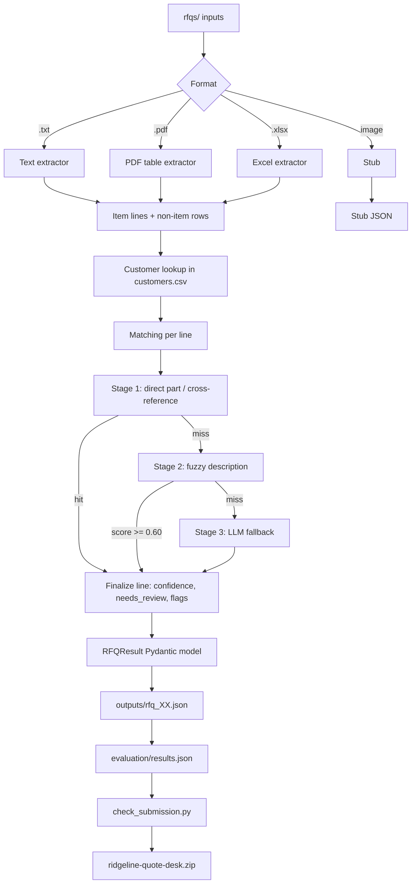

# Ridgeline Quote Desk

## Repository

https://github.com/osamahabib5/ridge_project_test_demo

## How to Run

Set up an isolated virtual environment and install the dependencies:

```
python -m venv .venv
.venv\Scripts\pip install -r requirements.txt
```

Copy `.env.example` to `.env` and set a real key (never commit `.env`):

```
copy .env.example .env
```

Run the pipeline — it writes the 6 JSON files to `outputs/` and refreshes `evaluation/results.json`:

```
.venv\Scripts\python ris_pipeline.py
```

(Add `--no-llm` to skip the DeepSeek fallback, e.g. when no key is set.)

Run the submission checker as the final step of the recorded session:

```
.venv\Scripts\python check_submission.py
```

If the pipeline produced `outputs/`, commit them before checking so they are tracked and included in the zip:

```
git add outputs evaluation ris_pipeline.py requirements.txt .env.example .gitignore README.md .chat-history
git commit -m "Ridgeline Quote Desk pipeline and deliverables"
```

## Approach

The pipeline ingests every RFQ format — `.txt`, `.pdf`, `.xlsx`, and images — into a common internal shape of item lines plus non-item instruction rows. Text emails are parsed as bullet lists, forwarded chains are read in full and reduced to the latest conversation (most recent changes override earlier ones), the PDF table is reconstructed with `pdfplumber` (falling back to `pypdf`), and the Excel sheet is read with `openpyxl` including "same as above" inheritance rows. Images are stubbed because they need OCR or a vision model.

Matching runs in three stages that stop at the first success:

1. **Direct part number** (`RL...` in `products.csv`) or **cross-reference** (`competitor_part_number` in `cross_reference.csv`), both at confidence 0.90.
2. **Fuzzy description** matching against `products.csv.description`; accepted at a score >= 0.60.
3. **LLM fallback** using the top 10 fuzzy candidates, at confidence 0.75, always flagged for review.

The single decision that matters most is the stage order plus the 0.60 fuzzy threshold: it decides when a line is trusted automatically, flagged for review, or escalated to the LLM, and is the main knob trading precision against recall.

The model provider is **DeepSeek V4 Pro** (`api.deepseek.com`, model `deepseek-v4-pro`, `reasoning_mode: high`); the API exposes a single global endpoint with no region selector, so no region is pinned. The key is loaded from the environment (`DEEPSEEK_API_KEY`) and never hard-coded.

## Evaluation

`evaluation/results.json` is recomputed by the pipeline on every run. Because the ground truth is the grader's answer key, these are self-reported heuristic metrics computed from the produced JSON, not from any ground-truth comparison:

- **threshold** — 0.60, the fuzzy acceptance score. Below it a line falls through to the LLM or is marked `no_match`.
- **extraction_accuracy** — share of non-stub lines with a non-null `quantity`.
- **match_precision** — share of matched lines matched by Stage 1 (`ridgeline_part_number` or `cross_reference`), the highest-precision sources.
- **match_recall** — share of non-stub lines that received any match (`match_method` is not null).

I chose 0.60 as the threshold because it is high enough to reject weak token overlaps but low enough to keep unambiguous descriptions (e.g. "6204-2RS bearings") in Stage 2 instead of burning LLM calls.

To grow the evaluation set I would add RFQs across more formats and verticals, maintain a separately labelled gold file (never `answer_key/`), add OCR/vision cases for handwriting, and track per-line confidence and `needs_review` distributions to recalibrate the threshold.

## Production



A rendered copy of this diagram is available at [ris_workflow.png](ris_workflow.png).

- **Failure isolation** — every file and every line is wrapped in try/except; a failure becomes a line with `flags=["unreadable_line"]` (or `["stub"]` for images) so the run always emits valid JSON.
- **Secrets** — `DEEPSEEK_API_KEY` is read from `.env` via python-dotenv; `.gitignore` excludes `.env`, and no secret is ever logged or committed.
- **Reproducibility** — deterministic stage ordering and line numbering; `outputs/` and `evaluation/results.json` are regenerated identically on each run.
- **Observability** — every line carries `match_method`, `confidence`, `needs_review`, `flags`, and a `note`; `check_submission.py` is the format gate before packaging.
- **Extensibility** — a format dispatcher makes adding new extractors (OCR, more email layouts, EDI) a single new function, and the catalog loads once per run.
